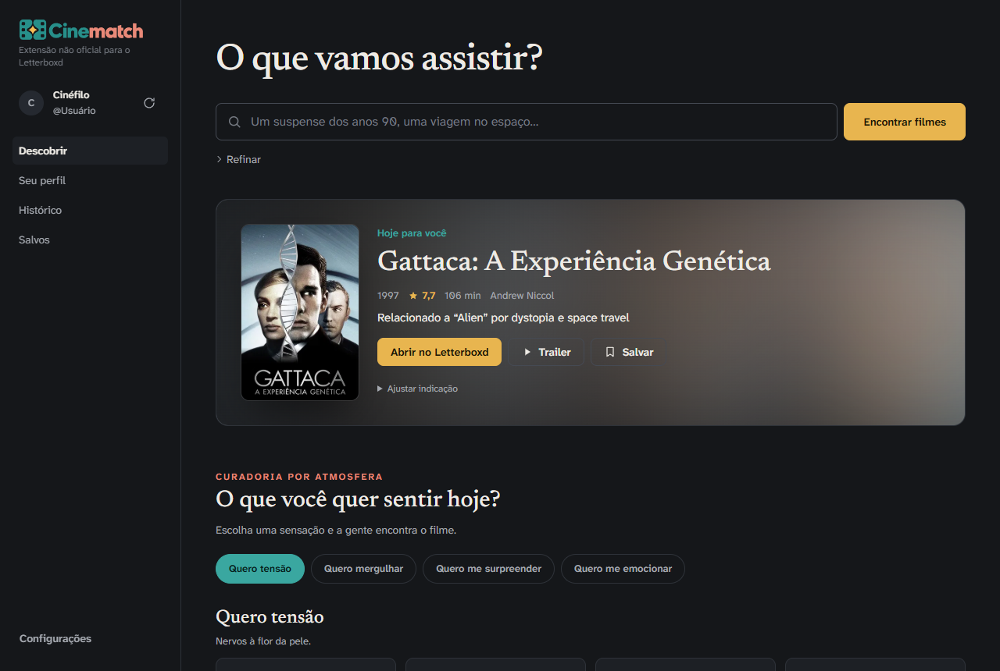
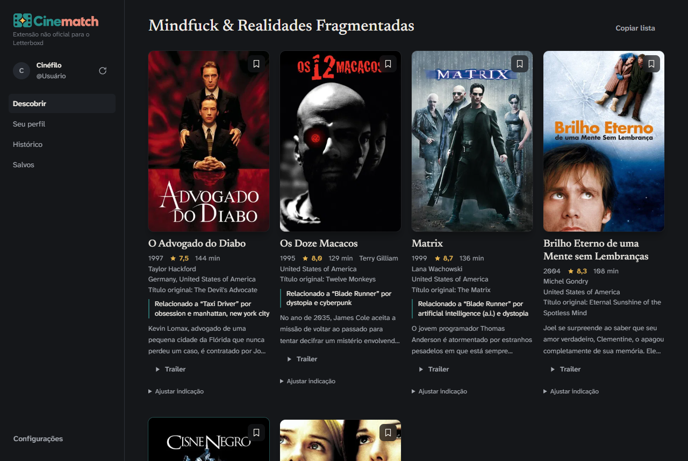
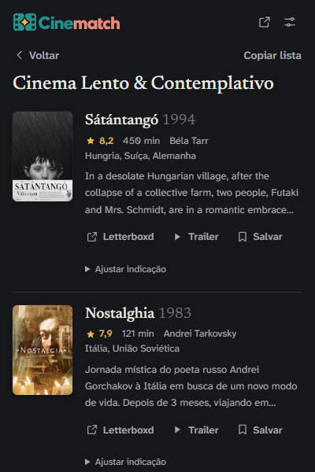

<p align="center"></p>

# CineMatch for Letterboxd (não oficial)

[](https://github.com/bumaruf/cinematch/actions/workflows/ci.yml)

Extensão Manifest V3 para Chrome que recomenda filmes a partir do seu perfil no
Letterboxd. Tudo roda no navegador: o motor de recomendação usa um catálogo
local (25 mil filmes no catálogo expandido atual) e não envia seu perfil a nenhum serviço de recomendação.

- **Recomendações por clima:** 15 atmosferas curadas, cada uma com um contrato
  de gêneros e sinais temáticos.
- **Busca em linguagem natural:** gêneros e países com alternativas e exclusões,
  período e duração, como "suspense ou ficção científica, sem terror, até 1h40".
  A tela mostra os critérios aplicados e explica conflitos entre texto e filtros.
  [Exemplos e limites da interpretação](docs/search-understanding.md).
  Protótipo opcional com o modelo do Chrome no dispositivo:
  [busca com o Gemini Nano](docs/on-device-model.md).
- **Recomendações automáticas:** seu gosto orienta as sugestões, respeitando
  os filtros e o clima escolhido, sem precisar escolher um modo de descoberta.
- **Sugestões próximas:** quando faltam opções específicas do clima, alternativas
  com contexto compatível são identificadas nos cards. Buscas vazias oferecem
  uma nova busca geral sem o pedido e os filtros.
- **Feedback local:** Hoje não (até amanhã), Não combina comigo e Já assisti,
  com Desfazer. Esses registros valem para o perfil ativo.
- **Avaliação opcional da curadoria:** no painel, registre adequação ao pedido
  e vontade de assistir, distinguindo filmes vistos de expectativas pela sinopse.
  Exporte ou apague as respostas em Seu perfil.
- **Filme do dia:** uma indicação diária determinística, baseada no que você
  avaliou bem.
- **Seu perfil, histórico e lista de salvos** no painel.

Não é afiliada ao Letterboxd, ao IMDb nem ao TMDB.

| Painel | Resultados | Popup |
|---|---|---|
|  |  |  |

## Desenvolvimento

Requer Node.js 24 ou mais recente.

O catálogo de filmes é derivado dos datasets do IMDb, licenciados apenas para
uso pessoal e não comercial, por isso não é versionado. Gere-o localmente antes
de usar a extensão (veja [Catálogo](#catálogo)). Para só compilar e testar,
um catálogo vazio basta:

```sh
npm install
npm run catalog:stub   # catálogo vazio: compila e roda os testes que não precisam de filmes
npm run check          # lint + typecheck + testes + build
```

Outros comandos:

```sh
npm run dev        # build em modo de desenvolvimento, com recarga
npm test           # Vitest (os testes com filmes reais rodam só com o catálogo gerado)
npm run lint       # Biome (só lint; o formatador está desligado)
npm run e2e        # carrega dist/ no Chromium e testa as telas (requer o catálogo)
npm run package    # gera cinematch-v<versão>.zip para a Chrome Web Store (requer o catálogo)
npm run icons      # regera a logo da interface e os ícones a partir de assets/brand
npm run diagnostics:recommendations # compara gostos com os mesmos assistidos e mede latência
npm run diagnostics:themes # confere contratos e cobertura por mínimo de votos
npm run diagnostics:performance # mede o motor com perfil sintético e relógio fixo
npm run diagnostics:package # verifica integridade e tamanho do catálogo no dist/ já gerado
```

Para instalar, abra `chrome://extensions`, ative o **modo do desenvolvedor**,
clique em **Carregar sem compactação** e selecione a pasta `dist/`.

### CI

O GitHub Actions roda typecheck, testes e build a cada push e pull request,
com o catálogo vazio. O teste de ponta a ponta e o empacotamento precisam do
catálogo real e rodam localmente.

## Arquitetura

O código segue camadas com uma regra de dependência verificada por
`tests/architecture.test.ts`. Detalhes em [docs/architecture.md](docs/architecture.md).

O catálogo é um recurso local comprimido, carregado quando uma operação precisa
dos filmes. Configurações e histórico podem responder sem carregar esses dados.
As medições e os comandos para comparar versões estão em
[docs/performance.md](docs/performance.md).

```
src/
  domain/          regras puras: catálogo, perfil, gosto, temas, recomendação
  application/     casos de uso e portas (interfaces que a infraestrutura implementa)
  infrastructure/  chrome.storage, Letterboxd (HTTP, parser, sincronização), catálogo
  messaging/       contrato tipado entre UI e service worker
  background/      service worker: monta as dependências e roteia as mensagens
  ui/              popup, painel, opções, content script e componentes (Tailwind CSS v4)
  data/            dados gerados (não editar à mão)
tools/
  catalog/         pipeline que gera src/data
  diagnostics/     teste de carga do motor e teste de ponta a ponta
  icons/           gera a logo e os ícones a partir de assets/brand
assets/brand/      logo e ícone originais (fonte da marca)
tests/             Vitest
docs/              arquitetura e screenshots
```

A UI conversa com o service worker só pelo contrato de `src/messaging`. Por isso
o catálogo (cerca de 27 MB no catálogo expandido atual) fica apenas no bundle do service worker, e as páginas abrem
sem carregá-lo.

## Sincronização com o Letterboxd

A sincronização lê as páginas públicas do perfil, reaproveitando a sessão de uma
aba aberta do Letterboxd quando existe (útil quando o site pede verificação).
O histórico é coletado em lotes de 3 páginas, com progresso salvo, para não
ultrapassar o limite de tempo do service worker. Falhas, perfis inexistentes e
coletas incompletas não substituem o perfil salvo. Depois de uma revisão
completa, sincronizações na mesma semana usam o RSS para atualizar só as
atividades recentes.

Também é possível importar `watched.csv`, `ratings.csv` e `diary.csv` da
exportação de dados do Letterboxd.

Mudanças no HTML do Letterboxd podem exigir ajustes em
`src/infrastructure/letterboxd/parse.ts`.

## Catálogo

`src/data/films-dataset.js` é gerado pelos scripts de `tools/catalog`:

```sh
npm run catalog:import    # títulos, anos, gêneros, diretores e notas dos datasets do IMDb (IMDB_CATALOG_LIMIT, padrão 10000)
npm run catalog:enrich    # termos temáticos
npm run catalog:pitches   # sinopses em português via TMDB (TMDB_API_KEY)
npm run catalog:posters   # pôsteres via TMDB (TMDB_READ_ACCESS_TOKEN)
npm run catalog:tmdb      # completa sinopses, países, idioma e duração via TMDB
npm run catalog:verify    # audita durações por IMDb ID; acrescente -- --apply para gravar
npm run catalog:dedup
```

Os mapas de pôsteres (`src/data/poster-catalog.js`) são versionados; o
catálogo e o checkpoint de sinopses, não.

`catalog:verify` consulta o dataset oficial `title.basics.tsv.gz` em streaming.
`IMDB_BASICS_PATH` permite usar uma cópia local TSV ou gzip. O comando mantém a
seleção atual e só aplica a revisão com `--apply`, após conferir a cobertura dos
identificadores. Backups e relatórios ficam em `e2e-screenshots/`, fora do Git.

Com `TMDB_READ_ACCESS_TOKEN` configurado no ambiente, `catalog:tmdb` retoma o
checkpoint e preserva os valores já conhecidos. `TMDB_THEME_EVIDENCE=1` seleciona
até 30 candidatos por clima para consultar palavras-chave dos próprios filmes;
rótulos antigos apenas escolhem o que consultar. `TMDB_BATCH_LIMIT` limita a
rodada e `TMDB_RETRY_INCOMPLETE=1` revisita registros incompletos já consultados.
O script não grava a credencial no catálogo ou no checkpoint.

### Fontes e atribuição

- Informações do [IMDb](https://www.imdb.com), dos datasets para uso pessoal e
  não comercial. Information courtesy of IMDb. Used with permission.
- Sinopses e pôsteres do [TMDB](https://www.themoviedb.org). This product uses
  the TMDB API but is not endorsed or certified by TMDB.

## Dados e privacidade

Perfil, preferências, histórico, filmes salvos, feedback e avaliações da curadoria ficam em `chrome.storage.local`.
Hoje não expira na virada do dia em São Paulo. Já assisti é uma marcação local;
não modifica o histórico sincronizado nem publica uma atividade no Letterboxd.
A extensão acessa apenas o Letterboxd (sincronização e pôsteres) e o CDN de
imagens do TMDB. Textos dinâmicos são escapados antes de entrar no HTML, e links
aceitam somente HTTP/HTTPS.

As palavras-chave novas registram sua origem (filme, gênero, diretor ou derivação).
Termos de gênero ou estilo herdados automaticamente não comprovam um clima ou uma
afinidade forte. Catálogos antigos recebem tratamento conservador; sinopses e dados
ausentes ainda limitam a precisão. Durações desconhecidas não recebem o valor
fictício de 100 minutos. A revisão local de 7 de outubro conferiu os 25 mil
identificadores; restam 45 durações e 860 países desconhecidos após o enriquecimento.

O método, os resultados e o roteiro para avaliar com seu perfil estão em
[docs/curation-validation.md](docs/curation-validation.md). Respostas humanas
ainda são necessárias para medir os acertos; testes automáticos conferem regras
e funcionamento, sem comprovar satisfação com a curadoria.

A ampliação das evidências de Cinema lento e Um único cenário, seus limites
de popularidade e a revisão posterior dos dados estão em
[docs/curation-coverage.md](docs/curation-coverage.md).

Use aspas para buscar um título que também seja um país ou um ano, como
`"Brazil"` ou `"1984"`. Feedback antigo pode ser revisto em **Seu perfil → Revisar feedback de sugestões**.

## Licença

Copyright (C) 2026 Contribuidores do CineMatch.

Este programa é software livre: você pode redistribuí-lo e/ou modificá-lo sob os
termos da [GNU General Public License versão 3](LICENSE), publicada pela Free
Software Foundation. É distribuído na esperança de ser útil, mas SEM NENHUMA
GARANTIA; sem mesmo a garantia implícita de COMERCIALIZAÇÃO ou de ADEQUAÇÃO A UM
DETERMINADO FIM.

A licença cobre o código. Os dados de terceiros listados em
[Fontes e atribuição](#fontes-e-atribuição) seguem os termos de cada fonte.
